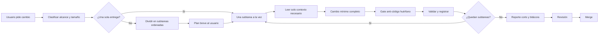

# Pipeline de desarrollo

## Flujo

## Reglas de tamaño

1. Una tarea = una entrega revisable (un endpoint, un componente, una corrección).
2. Si el pedido incluye más de una entrega o cruza backend + frontend + base de
   datos, el agente lo divide en subtareas ordenadas y lo informa en un mensaje
   corto. El usuario no tiene que dividirlo por él.
3. Se ejecuta una subtarea a la vez: implementar, validar, registrar y recién
   entonces seguir. Nunca implementar todo y probar al final.
4. Una subtarea está completa solo cuando compila/pasa validación y su cableado
   está hecho. No iniciar la siguiente sobre una base rota.
5. Si la realidad contradice el plan, ajustar el plan y avisar. No ampliar el
   scope al dividir.

## Decisiones y preguntas

1. El agente decide lo técnico (nombres, estructura, dependencia mínima, orden
   de subtareas) y lo informa en el reporte. No pregunta por ello.
2. Solo se pregunta cuando la respuesta: cambia requisitos del producto, es
   difícil de revertir, involucra credenciales, datos privados o permisos, o
   cuando dos lecturas razonables producen entregas distintas.
3. No se pregunta: si continuar, si agregar extras no pedidos (no se agregan),
   ni nada que se responda leyendo el código.
4. Las preguntas van una sola vez, agrupadas en un mensaje, con opciones y una
   recomendación. En lo no bloqueante se avanza con supuestos explícitos.
5. Sin ida y vuelta por preferencias: elegir, documentar la decisión, seguir.

## Contrato compartido front ↔ back

Cada equipo y cada agente ve un solo repositorio: quien hace el frontend no ve
cómo está hecho el servidor y quien hace el backend no ve la interfaz. El único
puente es `planificacion_modulos_y_endpoints_galash_is_2026.md`, cuyas copias
en `Galash-IS` y `Galash-IS-Backend` deben ser **idénticas byte a byte**.
Cualquier diferencia entre ambas copias es un defecto.

1. Toda tarea que toque servicios, endpoints, cargas, errores o autenticación
   consulta primero la sección del módulo afectado del contrato (filtrar por
   endpoint o encabezado; nunca cargar el archivo completo).
2. Se implementa exactamente el contrato: mismo método, ruta, roles, campos y
   comportamiento de errores. Lo que llegue por input (servicios, tipos,
   catálogos como `endpoints.md`, especificación pegada por el usuario) no
   reemplaza al contrato: si hay diferencia entre lo recibido y el contrato,
   se reporta el desajuste; no se sigue a ninguna de las dos versiones en
   silencio.
3. Cambio de interfaz entre los lados (endpoint agregado, eliminado o
   renombrado; campo, código de estado, formato de error o flujo de
   autenticación) = cambio de contrato: primero se actualiza el contrato,
   luego el código, y se registra en reporte y bitácora el texto exacto que el
   otro repositorio debe copiar para sincronizar su copia.
4. Si el otro repositorio no está accesible, la sincronización queda como
   pendiente explícito. No se considera hecho hasta que la copia del otro lado
   esté actualizada.
5. Nunca inventar endpoints ni campos fuera del contrato.
6. Todo servicio o endpoint nuevo se registra en `servicios.md` en cuanto queda
   operativo. El formato es idéntico en ambos repos y solo cambia la columna
   `Uso` (marca del front). Una tarea que cree o cambie servicios sin
   registrarlos está incompleta.
7. El envío de `servicios.md` es unidireccional: backend -> front. Al cerrar
   una tarea que cree o cambie servicios, el agente recuerda al desarrollador
   pasarlo al front. Sin ese paso, el front sigue construyendo contra
   información vieja.

## Gate anti-código huérfano

Antes de reportar "completado", el agente cuestiona cada pieza que creó:

1. ¿Está conectada? Ruta registrada, import usado, componente invocado,
   configuración actualizada.
2. ¿Se alcanza desde un flujo real (UI, API, CLI)?
3. ¿Tiene validación o prueba que falle si se rompe?
4. ¿Requerirá intervención de alguien más para que funcione?
5. ¿Coincide con el contrato compartido? Frontend que llama servicios que no
   existen en el contrato y backend con endpoints que nadie consume también son
   código huérfano.

Si alguna respuesta es no: terminar el cableado mínimo ahora, o declarar el
pendiente de forma explícita en el reporte y en la bitácora. Nada queda
incompleto en silencio. El código que no se usa se elimina o se marca pendiente
con su tarea de completado.

## Reglas de costo

1. Lectura mínima: solo archivos del alcance (ver `AGENTS.md` / Context limits).
   No releer archivos ya leídos ni cargar logs completos.
2. Validar solo el alcance del cambio; no ejecutar verificaciones globales
   salvo que el cambio lo exija.
3. Reporte final corto: archivos cambiados, pruebas, decisiones tomadas,
   pendientes explícitos e impacto en el otro lado (qué debe sincronizar o
   hacer el otro equipo). Sin narrativa larga.

## Archivos clave

| Archivo | Función |
|---|---|
| `AGENTS.md` | Reglas de agentes y lectura contextual |
| `servicios.md` | Registro compartido de servicios y endpoints; columna `Uso` solo en el front |
| `docs/contexto.md` | Estado técnico actual |
| `docs/bitacora.ndjson` | Historial técnico append-only |
| `docs/testing/README.md` | Instrucciones de pruebas |
| `docs/testing/events.ndjson` | Eventos de pruebas |
| `docs/testing/dashboard/` | Dashboard generado |
