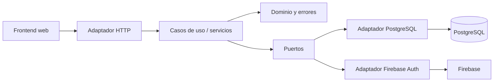

# Arquitectura

El backend está organizado como un monolito modular con arquitectura hexagonal.
Las entidades y reglas de negocio no dependen del transporte HTTP ni de PostgreSQL.

## Capas

| Capa | Ubicación | Responsabilidad |
|---|---|---|
| Dominio | `internal/domain` | Entidades, estados y errores del negocio |
| Puertos | `internal/ports` | Interfaces de entrada y salida |
| Aplicación | `internal/application` | Casos de uso y autorización de negocio |
| Adaptadores | `internal/adapters` | HTTP, PostgreSQL y Firebase |
| Composición | `cmd/api` | Construcción de dependencias |

La composición se inicia desde `main.go`. PostgreSQL y Firebase se conectan mediante
adaptadores; el handler HTTP registra todas las rutas en un único `ServeMux`.
