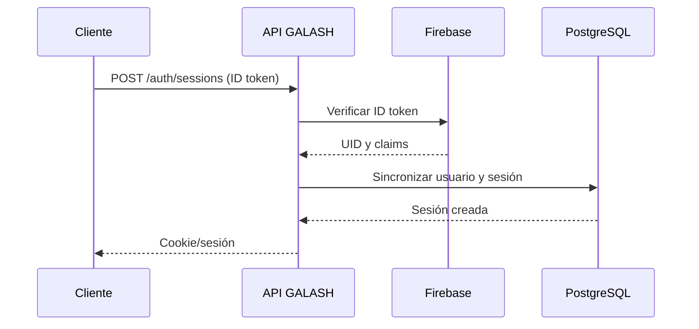
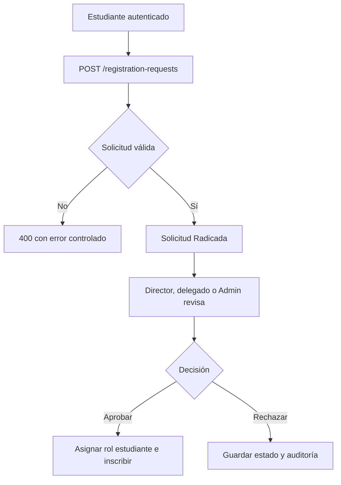

# Flujos principales

## Autenticación y sesión



## Solicitud de registro



## Archivos asociados

```mermaid
flowchart LR
    U[Usuario autorizado] --> UP[POST /files]
    UP --> V[Validar entidad, extensión y 10 MB]
    V --> P[(PostgreSQL)]
    U --> DL[GET /files/{id}]
    DL --> AUTH[Revalidar acceso a entidad]
    AUTH --> P
```
